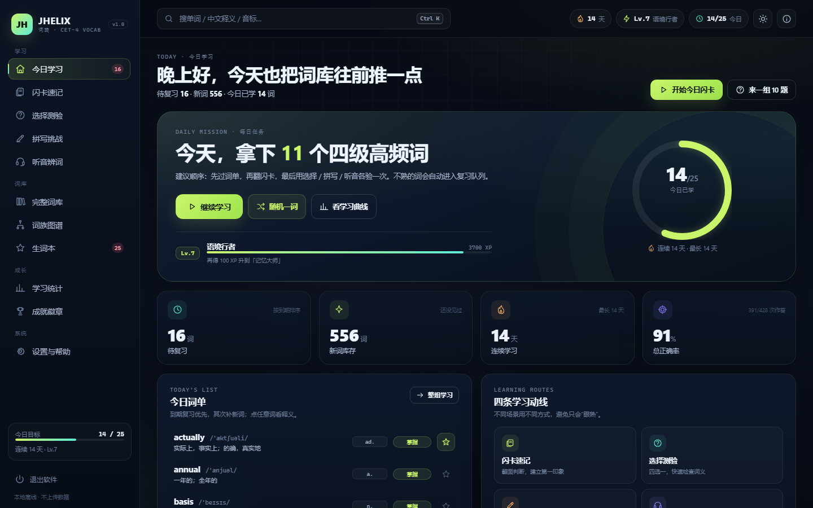
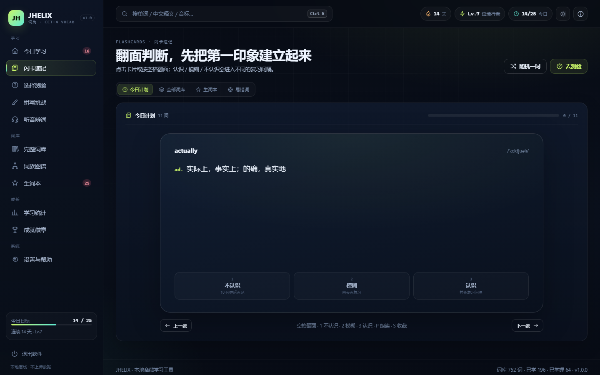
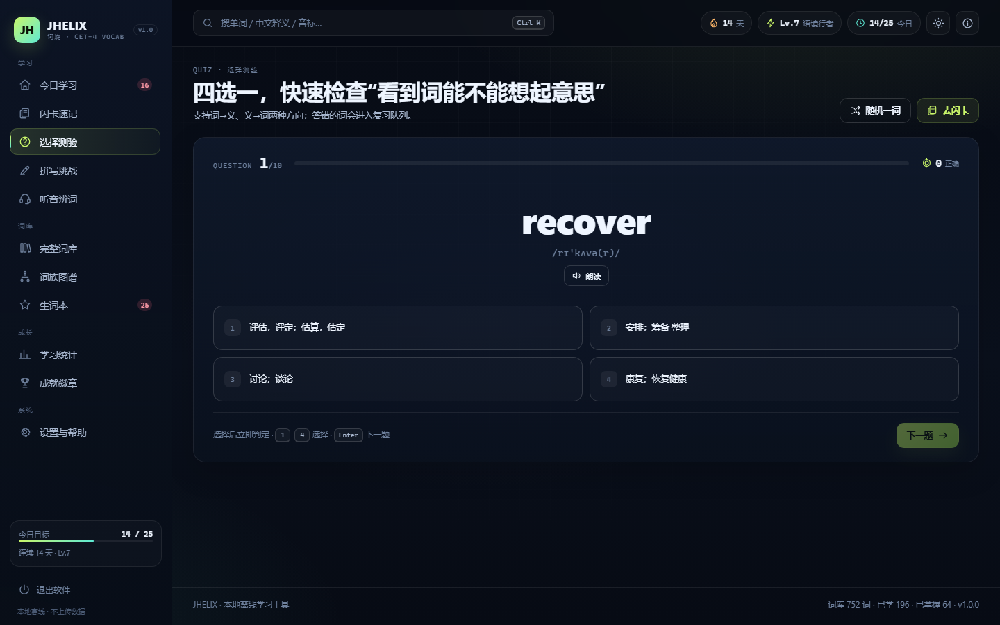
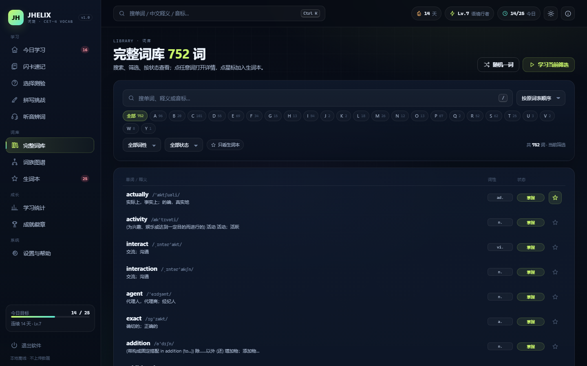
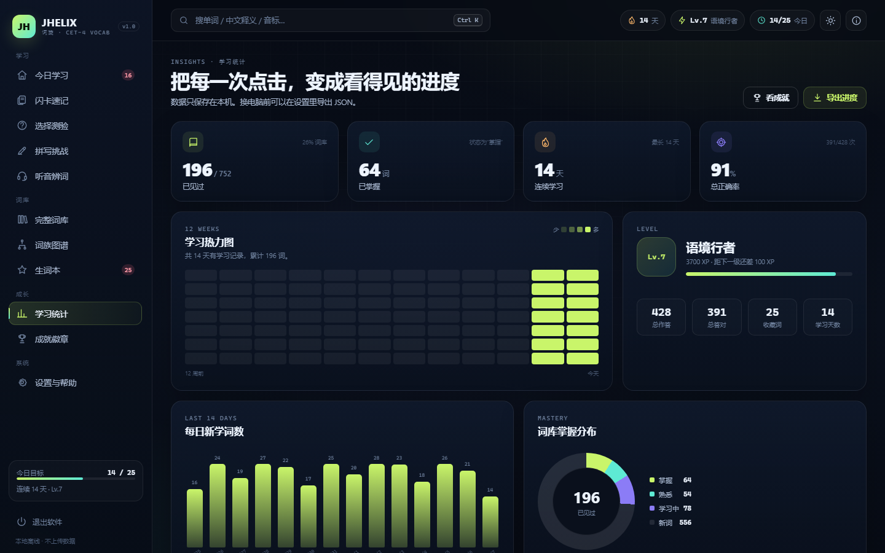
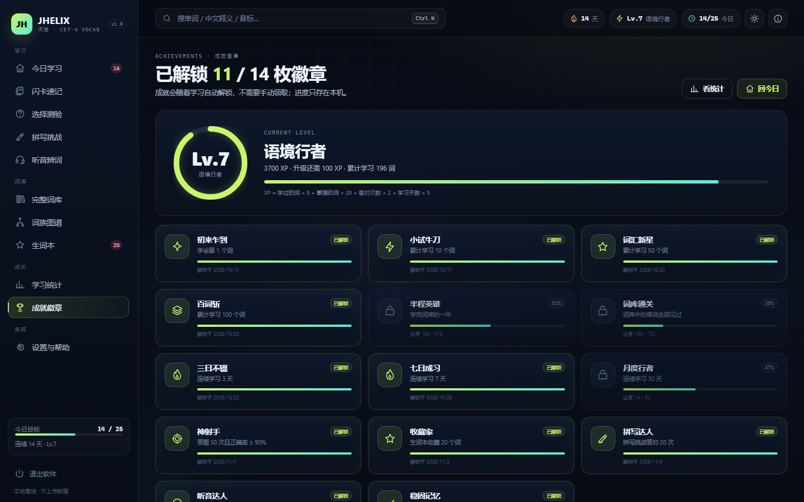

# JHELIX

**词旋 · CET-4 词汇学习桌面工具**  
by **J. Helix**（JH）

> 本项目源码完全公开，任何人可以学习、使用、修改和分享，但**禁止任何商业用途**。

### 使用许可（一句话版）

- **可以**：个人学习、研究、教学、非营利组织使用；阅读、修改、分享源码。
- **不可以**：收费售卖、商业产品内置、商业培训、企业内部商业运营等任何商业用途。
- **商业授权**：需要单独联系作者 **J. Helix** 获得书面许可。

把两份四级高频词 docx 变成一个可点击、可复习、完全离线的 Windows 桌面学习工具。

无框架、无构建步骤、无账号、无云端请求。运行时只依赖 Python 标准库；界面使用原生 HTML / CSS / JavaScript，数据保存在本机 `localStorage`。

## 在线使用

不想装 Python 的话，直接打开在线版：

**https://jhelix-arch.github.io/JHELIX/**

源码仓库：**https://github.com/JHELIX-Arch/JHELIX**

在线版和桌面版共用同一套界面与本地学习记录，打开浏览器就能背单词。学习进度仍然只保存在当前浏览器的 `localStorage`，不会上传到服务器。

## 名字

**JHELIX** = **JH** + **HELIX**。JH 是开发者的姓名缩写，HELIX 是螺旋：同一批词不是学一遍就结束，而是在更高的精度上反复回到你面前。中文名「词旋」取的也是这个意思。

软件名为 **JHELIX**，开发者署名为 **J. Helix**。

| 今日学习 | 闪卡速记 |
| --- | --- |
|  |  |

| 选择测验 | 词库 |
| --- | --- |
|  |  |

| 学习统计 | 成就徽章 |
| --- | --- |
|  |  |

## 功能

- **11 个板块**：今日学习、闪卡速记、选择测验、拼写挑战、听音辨词、词库、词族图谱、生词本、学习统计、成就徽章、设置与帮助。
- **完整学习闭环**：新词 → 学习中 → 熟悉 → 掌握，按 1 / 3 / 7 / 15 / 30 / 60 天逐级拉长复习间隔。
- **多种练习方式**：翻转闪卡、四选一测验、拼写输入、听音辨词、错词重练。
- **词库浏览**：按字母、词性筛选，全文搜索（单词 / 释义 / 音标），单词详情页联动同族词与形近词。
- **成长反馈**：每日目标、连续学习天数、XP 等级、14 个成就、最近 14 天学习图表。
- **本地优先**：学习记录只写入浏览器 `localStorage`；设置页支持 JSON 导入 / 导出与清空进度。
- **桌面体验**：本地 HTTP 服务 + Edge `--app` 无地址栏窗口；单实例复用、窗口关闭后心跳超时自动退出、深色 / 浅色主题。
- **键盘操作**：全站搜索、板块跳转、闪卡判定、测验选项、听音重播均可只用键盘完成。

## 快速开始

### 环境

- Windows 10 / 11
- Python 3.8+
- Microsoft Edge（推荐）或任意现代浏览器
- 运行软件不需要安装任何第三方 Python 包

### 启动

```bash
cd CET4_Vocab
python app.py
```

也可以双击项目根目录的 `启动JHELIX.cmd`。

启动后 `app.py` 会：

1. 在 `127.0.0.1:47840-47879` 中寻找可用端口；
2. 用 Edge 应用窗口打开界面（找不到 Edge 时回退到默认浏览器）；
3. 窗口关闭后，120 秒心跳超时自动退出，不留后台进程。

### 创建桌面快捷方式

```powershell
powershell -ExecutionPolicy Bypass -File tools\make_shortcut.ps1
```

脚本会自动定位 `pythonw.exe` 和项目根目录，并在桌面生成 `JHELIX CET-4.lnk`。如果自动定位失败，可以显式指定：

```powershell
powershell -ExecutionPolicy Bypass -File tools\make_shortcut.ps1 -Pythonw "C:\Path\To\pythonw.exe"
```

验证快捷方式：

```powershell
powershell -ExecutionPolicy Bypass -File tools\check_shortcut.ps1
```

### 无窗口模式

```bash
python app.py --no-window
```

服务仍监听本机端口，适合调试或配合自动化测试使用。

## 键盘快捷键

| 快捷键 | 作用 |
| --- | --- |
| `Ctrl + K` / `/` | 聚焦全局搜索 |
| `Alt + 1` … `Alt + 9` | 依次跳转到前 9 个板块 |
| `Alt + 0` | 打开设置与帮助 |
| `Esc` | 关闭弹窗 / 搜索下拉 |
| `Space` | 闪卡翻面 |
| `1` / `2` / `3` | 闪卡判定：不认识 / 模糊 / 认识 |
| `←` / `→` | 闪卡上一张 / 下一张 |
| `1` … `4` | 测验、听音辨词选择选项 |
| `Enter` / `Space` | 提交答案或进入下一题 |
| `R` | 听音辨词重播当前单词 |

## 重建词库

仓库自带 `ui/data/words.json`（当前为 893 条原始条目去重后的 752 个词）。如果要换成自己的词表：

```bash
python -m pip install python-docx
python tools/build_data.py 词汇1.docx 词汇2.docx
```

源文件每个非空行需要形如：

```text
actually [ˈæktʃuəli] ad. 实际上，事实上；的确，真实地
```

可选参数：

```bash
python tools/build_data.py 词汇1.docx 词汇2.docx --out ui/data/words.json --name "我的词库"
```

构建脚本只做确定性清洗：去 BOM、按小写单词去重、拆分音标 / 词性 / 释义、生成短释义，不补写原稿没有的内容。输出中的 `sources` 只记录文件名，不记录本机绝对路径。

如需重新生成应用图标（需要 Pillow 和 Windows 中文字体）：

```bash
python -m pip install pillow
python tools/make_icon.py
```

## 测试

交互冒烟测试使用浏览器 CDP，不依赖测试框架。需要 Node.js 22+：

```bash
node tests/smoke_test.mjs
```

脚本会：

- 自动探测 `47840-47879` 上已运行的 JHELIX 服务；
- 如果没有服务，自动执行 `python app.py --no-window`；
- 用独立的临时浏览器配置跑完 32 项检查（品牌署名、词库、导航、收藏、详情、闪卡、SRS 写入、刷新持久化、测验、搜索、主题、全部板块渲染、运行时异常）。

可选环境变量：

```bash
JHELIX_BASE=http://127.0.0.1:47840   # 指定已运行的服务
EDGE_PATH="C:\Path\To\msedge.exe"   # 指定 Edge / Chrome
JHELIX_CDP_PORT=9333                 # 指定 CDP 调试端口
PYTHON=python                       # 指定启动服务用的 Python
```

## 项目结构

```text
CET4_Vocab/
├─ app.py                     # 本地 HTTP 服务、单实例、窗口与看门狗
├─ 启动JHELIX.cmd              # Windows 双击启动
├─ ui/
│  ├─ index.html              # 应用外壳与 SVG 图标精灵
│  ├─ css/app.css             # 设计系统、布局、组件、响应式
│  ├─ js/
│  │  ├─ util.js              # DOM / 格式化 / 弹窗 / 提示 / 朗读
│  │  ├─ store.js             # localStorage 状态、SRS、统计、成就
│  │  ├─ data.js              # 词库加载、搜索、词族、形近词
│  │  ├─ pages.js             # 11 个板块与单词详情
│  │  └─ app.js               # 路由、导航、全局事件、快捷键、心跳
│  ├─ data/words.json         # 构建产物
│  └─ assets/                 # 图标
├─ tools/
│  ├─ build_data.py           # docx → words.json
│  ├─ make_icon.py            # 生成 favicon
│  ├─ make_shortcut.ps1       # 创建桌面快捷方式
│  └─ check_shortcut.ps1      # 校验快捷方式
├─ tests/smoke_test.mjs       # 32 项端到端交互测试
└─ docs/ARCHITECTURE.md       # 进程模型、API、状态与数据管线
```

## 架构摘要

```text
┌──────────────┐   HTTP 127.0.0.1   ┌─────────────────────────────┐
│ Edge --app   │ ─────────────────> │ app.py                      │
│ 原生 HTML/JS │ <───────────────── │ ThreadingHTTPServer         │
└──────┬───────┘   /api/beat 等      │ 静态文件 + 心跳看门狗       │
       │                             └──────────────┬──────────────┘
       │ localStorage                               │ 读取
       ▼                                            ▼
  学习进度 / 设置                        ui/data/words.json
```

- 服务只绑定回环地址，不接受外部连接。
- 静态文件只能读取 `ui/` 目录，解析后校验路径前缀，阻止目录穿越。
- 前端每 3 秒发送一次心跳；后台 120 秒收不到心跳就退出。
- 第二次启动会探测已有实例，复用端口并只打开新窗口，不重复起服务。

更完整的进程生命周期、API、状态模型和 SRS 规则见 [docs/ARCHITECTURE.md](docs/ARCHITECTURE.md)。

## 技术定位与限制

这个项目的价值在**产品完成度和桌面外壳**，不在算法：

- 学习调度是固定的 7 级间隔表，不是 SM-2 / FSRS；
- 词族按 4–7 位公共前缀分组，形近词用编辑距离 ≤ 2 筛选，都是字符串启发式，不是词源分析；
- 不包含任何 GSJ 或其他专有核心算法；
- 目前以 Windows + Edge 为主；服务本身可跨平台，但应用窗口和快捷方式脚本是 Windows 实现；
- 不打包 exe，需要本机 Python；这是为了绕开 Smart App Control 等安装限制；
- 只有闪卡和详情页的判定会推进复习间隔；选择、拼写、听音练习只记录正确率，答错会把复习提前到 10 分钟后；
- 进度存在 `localStorage`，清理浏览器数据会丢失，建议定期在设置页导出 JSON；
- 朗读依赖系统 TTS 语音，不同机器音色和可用性不同；
- 无账号、无云同步、无多设备合并。

## 数据与版权

随仓库附带的 `ui/data/words.json` 来自项目所有者提供的两份四级词汇 docx。单词、音标和中文释义可能来源于第三方词汇资料，其权利归原作者或出版方所有。

- 代码以 PolyForm Noncommercial 1.0.0 许可证公开，**仅限非商业用途**；该许可证不自动覆盖词库数据。
- 词库仅用于个人学习与技术演示，禁止商业使用。
- 如果权利人认为分发这些词条构成侵权，请提交 issue，核实后会移除相关数据。
- 你可以删除 `ui/data/words.json`，用 `tools/build_data.py` 生成自己的词库。

详见 [NOTICE](NOTICE)。

## 许可证

源代码采用 [PolyForm Noncommercial 1.0.0](LICENSE) 公开，**仅限非商业用途**。

这不是 OSI 定义下的“开源许可证”，而是“源码公开、禁止商用”的许可：个人学习、研究、教学和非营利组织可以使用；任何商业使用都需要单独获得作者书面授权。

词库数据不在此许可证覆盖范围内，详见 [NOTICE](NOTICE)。
